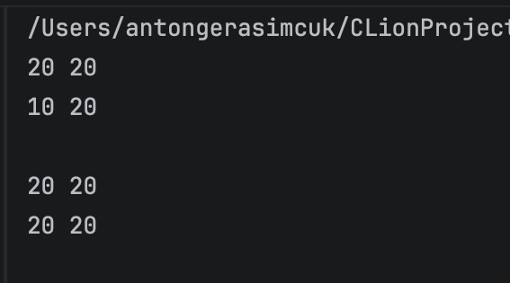
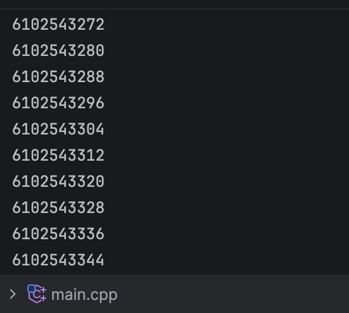

# Языки программирования
## Лабораторная работа 10

### Задание 1 **(2)**

*Рассмотрим следующие фрагменты программ.*
```
int a = 10, b = 20;
int *p = &a , *q = &b;
p = q
std::cout << *p <<' '<< *q << std::endl;
```
```
int a = 10, b = 20;
int *p = &a , *q = &b;
*p = *q
std::cout << *p <<' '<< *q << std::endl;
```
*Чем различаются присваивания в третьей строке? Что можно вывести,
чтобы показать различия?*

*Примеры программ сохраните в папке с номером задания.*

## Ответ

* в C зависит от места: в int *p это часть типа, в a * b — умножение, а в *p — разыменование. Если int a=10, b=20; int *p=&a, *q=&b;, то p = q копирует адрес: теперь p и q указывают на b, но a и b не меняются (a=10, b=20). А *p = *q копирует значение: 20 из b записывается в a, получается a=20, b=20, но указатели всё ещё смотрят на разные переменные.

  

### Задание 2 **(1)**

*Рассмотрим следующую программу.* 
```
double x[10];
for (int i = 0; i <1 0; i++)
    std::cout << &x[i] << std::endl;
```
*Что она выводит? Измените
вывод так, чтобы адреса выводились в десятичной системе счисления.
Объясните почему числа составляют арифметическую прогрессию с
определенным шагом.*

*Записанную программу сохраните в папке с номером задания.*

## Ответ



Программа выводит адреса элементов массива, приводя их к типу size_t для отображения в десятичном виде. Элементы массива расположены в памяти непрерывно, а тип double занимает 8 байт, поэтому адрес каждого следующего элемента ровно на 8 байт больше предыдущего. Из-за этого адреса образуют арифметическую прогрессию с постоянным шагом 8. При каждом запуске начальный адрес может меняться, но расстояние между элементами (шаг) всегда остается неизменным и равным размеру типа double.

### Задание 3 **(2)**

*Токен* **«*»** *в языке C++ может использоваться в трех различных
случаях. Аналогично токен* **«&»** *также может использоваться в трех
случаях. Приведите пример одной программы в которой они были бы
использованы во всех случаях.*

*Записанную программу сохраните в папке с номером задания.*

### Задание 4 **(2)**

*Выпишите значения всех переменных, в том числе указателей,
после выполнения каждой инструкции программы. Объясните, что
происходит в результате выполнения каждой инструкции.*
```
unsigned a = 8, b = 3 ,c = 17;
unsigned *p = &a;
unsigned *q = &b;
*p += *q + c;
c = *q;
p = &c;
c += a;
*p += 10;
*q = *p;
q = p ;
*q += 10;
```

### Задание 5 **(1)**

*Что сравнивается в приведенной ниже программе? Как можно
изменить первую строчку программы, чтобы результат тоже
изменился?*
```
int x = 1, y = 2;
int *p = &y, *q = &x;
if (p < q)
    std::cout << "Yes";
else
    std::cout << "No";
```

## Ответ

Указатели p и q хранят адреса переменных y и x, поэтому выражение p < q сравнивает их расположение в памяти, а не сами значения 2 и 1. Изменение значений переменных не влияет на результат, так как их адреса остаются прежними. Если изменить порядок объявления на int y = 2, x = 1;, переменные займут другие места в памяти, из-за чего результат сравнения адресов поменяется на противоположный вместо "Yes" выведется "No".

### Задание 6 **(2)**

*Объясните работу следующей программы. Как изменится
результат, если тип* **double** *изменить на некоторый другой, например*
**int** *или* **char**?
```
double x = 0;
double *d = &x;
std::cout << reinterpret_cast<size_t>(d + 4) - reinterpret_cast<size_t>(d - 4) << std::endl;
```

## Ответ

В арифметике указателей выражение d+4 сдвигает адрес вперед на 4 элемента, а d-4 — назад на 4. Если привести эти указатели к size_t и вычесть один из другого, получится разница в байтах, равная 8 * sizeof(тип). Применять такие смещения к одиночной переменной некорректно, так как выход за её границы — это неопределенное поведение. Проверять это нужно на массиве, взяв указатель на его середину.

### Задание 7 **(2)**

*Объясните работу следующей программы. Как изменится
результат, если тип* **double** *изменить на некоторый другой, например*
**int** *или* **char**?
```
std::cout << reinterpret_cast <double*>(3000) - reinterpret_cast <double*>(2000) << std::endl;
```

## Ответ 

Берется разность числовых значений адресов и делится на размер типа: (3000 - 2000) / sizeof(тип). При стандартных размерах типов получаем: для double 1000 / 8 = 125, для int 1000 / 4 = 250, для char 1000 / 1 = 1000. Однако по правилам языка вычитать указатели можно только в пределах одного массива. Поскольку здесь используются произвольные адреса, такая операция приводит к неопределенному поведению, и полученные результаты не гарантированы.

### Задание 8 **(2)**

*Что надо дописать в записанной ниже программе вместо многоточий, чтобы
она выводила все числа из массива* **a**? *Почему?*
```
int a[20];
for ( int i = 0; i < 20; i++)
    a[i] = i;
int *b=a + 8;
for (int i =...; i <...; i++)
    std::cout << b[i] <<' ';
```

## Ответ

```
#include <iostream>

int main() {
    int a[20];
    for ( int i = 0; i < 20; i++)
        a[i] = i;
    int *b=a + 8;
    for (int i = -8; i < 12; i++)
        std::cout << b[i] <<' ';
    return 0;
}
```

Указатель b инициализирован как a + 8, то есть он указывает на элемент с индексом 8. Массив a состоит из 20 элементов. Чтобы вывести весь массив с помощью указателя b, нужно обращаться к элементам с отрицательными индексами и положительными. Начало массива a[0] относительно b находится по индексу -8, а конец a[19] — по индексу 11. Поэтому переменная i должна начинаться с -8 и идти до 11.

### Задание 9 **(2)**

*Что выводит следующая программа? Изменится ли результат если
изменить тип элементов массива?*

```
int a[10];
std::cout << &a[8] - &a[3] << std::endl;
```

### Задание 10 **(1)**

*Есть ли разница между инициализацией* **p** и **q** *в следующей программе? Обоснуйте ответ.*
```
int x [10]={1, 2, 3, 4, 5, 6, 7, 8, 9, 10};
int *p = x + 5;
int *q = &x[5];
```

### Задание 11 **(3)**

*Указатели можно использовать для итерации по массивам.
Напишите программу, которая найдет сумму элементов массива,
используя указатели. В начале цикла указатель требуется установить
на начало массива, в конце каждой итерации смещать его к
следующему элементу массива через инкремент. Для выхода из цикла
надо проверять, что указатель дошел до конца массива.*
```
int x [10]={1, 2, 3, 4, 5, 6, 7, 8, 9, 10};
int s = 0;
for (int *p = ...; ...; ...)
    s += ...
std::cout << s;
```

*Записанную программу сохраните в папке с номером задания.*


## Дополнительные задания

### Задание 1 **(3)**

*Запишите программу на С++, в которой будет создаваться двумерный массив* **x[10][10]**. *Выведите адреса элементов массива и нарисуйте, как элементы расположены в памяти.*

### Задание 2 **(3)**

*Запишите программу на С++, в которой будет создаваться двумерный массив* **x[10][10]**. *Проверьте, что произойдет при различных выходах за границы массива. Напишите программы для демонстрации и поясните
их работу.* 

### Задание 3 **(6)**
*Напишите пример программы, которая продемонстрирует неопределенное поведение при выходе за границу одномерного массива. Например, чтобы программа зависла, хотя по алгоритму такого не должно произойти

### Задание 4 **(8)**
*Изучите самостоятельно работу с динамической памятью. Напишите примеры программ, демонстрирующие особенности работы (например, перемещение при расширении) и возможные ошибки при работе с памятью.* 

