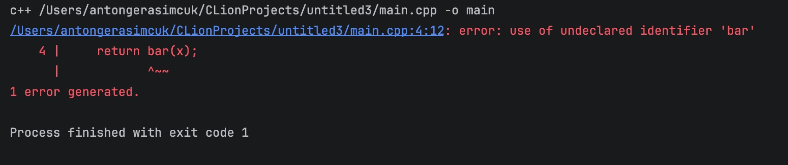

# Языки программирования
## Лабораторная работа 11

### Задание 1 **(2)**

*Что надо дописать в приведенный пример программы, чтобы она транслировалась без ошибок?
Существующий код нельзя изменять или переставлять.*

```
int foo(int x) {
    return bar(x);
}
int bar(int x) {
    return x+1;
}
int main() {
    foo(0);
    return 0;
}
```

## Ответ



```cpp
#include <iostream>
int bar(int x);

int foo(int x) {
    return bar(x);
}
int bar(int x) {
    return x+1;
}
int main() {
    foo(0);
    return 0;
}
```

### Задание 2 **(1)**

*Функция* **dswap** *должна была обменивать значения своих параметров.* 
*(На выводе должно было получиться* ```3.4 1.5```.)
*В чем ошибка при написании этой функции? Как ее исправить? 
Что передавалось в параметры у исходной функции и у исправленной?* 
```
#include <iostream>
void dswap(double x, double y) {
   double t = x;
   x = y;
   y = t;
}
int main(void) {
   double x = 1.5, y = 3.4;
   dswap(x, y);
   std::cout << x << " " << y << std::endl;
   return 0;
}
```

## Ответ 

```cpp
#include <iostream>
void dswap(double& x, double& y) {
    double t = x;
    x = y;
    y = t;
}
int main(void) {
    double x = 1.5, y = 3.4;
    dswap(x, y);
    std::cout << x << " " << y << std::endl;
    return 0;
}
```

### Задание 3 **(3)**

*Известно, что функция* **dosome** *не изменяет значений вектора* **V**.
*Какие из способов объявления функции является правильным с точки зрения 
корректности работы программы? В чем разница между этими способами?*


```
void dosome(const vector<int> &V);
void dosome(vector<int> &V);
void dosome(const vector<int> V);
void dosome(vector<int> V);
```

*Проверьте в какие из этих функций можно передать константные вектора. ОЛбъясните результат.*
```
dosome({1, 2, 3});
```

## Ответ

Если функция только считает сумму, то для обычного вектора A все четыре варианта дадут одинаковый результат 15. const означает «через этот параметр нельзя менять объект», а & означает «передать по ссылке, без копии». Поэтому const vector<int>& не копирует вектор и запрещает его менять: он подходит и для обычного вектора, и для константного, и для временного {1,2,3}. vector<int>& тоже не копирует, но разрешает менять вектор, поэтому ему нельзя передать константный вектор или временный объект — будет ошибка. const vector<int> создаёт копию и запрещает менять эту копию, поэтому работает с константным вектором и с временным объектом. vector<int> тоже создаёт копию, но её менять можно; исходный вектор не изменится. Для чтения вектора лучше const vector<int>&: нет лишней копии и нельзя случайно изменить исходный вектор. Остальные варианты в обычном случае тоже рабочие, но либо делают копию, либо не подходят для константного вектора и временного объекта.

### Задание 4 **(2)**

*Напишите программу в которой будет создаваться восемь массивов из 128 целых чисел четырьмя способами,
каждым способом по два массива.
Первые два массива должны быть глобальными, вторые — локальными статическими, третьи — локальными на стеке,
четвертые — локальными в куче. Выведите адреса первого и последнего элемента в каждом массиве.
Сравните, насколько далеко они располагаются друг от друга. Какие выводы можно из этого сделать.*

*В отчет запишите программу и скриншот ее работы.*

## Ответ

Глобальные и статические объекты создаются один раз и дальше не пересоздаются: глобальные создаются до входа в main, видны из любой функции и удаляются после завершения программы; локальные статические создаются при первом выполнении своего объявления, видны только внутри своей функции и удаляются при завершении программы; обычные локальные объекты создаются при входе в функцию, видны только внутри неё и удаляются при выходе; объекты в куче создаются и удаляются по запросу через new/delete (или new[]/delete[]), и временем их жизни управляет программист.

### Задание 5 **(2)**

*Приведенная ниже программа вызывает ошибку. Почему?*

*Что будет, если перенести объявление массива выше функции* **foo**?

*Что будет, если объявить массив с использованием ключевого слова* **static**?

*Что будет, если создать массив такого же размера с использованием* **new**?
```
#include <iostream>
int foo() {
    int x[100010001];
    return x[100010000];
}
int main() {
    std::cout << foo();
    return 0;
}
```


### Задание 6 **(3)**

*Запишите следующую программу. Выполните ее трансляцию с нулевым оровнем оптимизации.
Нарисуйте схематично расположение переменных в памяти в момент вызова при \verb*|a=0|. 
Отметьте кадры стека.*

```
#include <iostream>
long long foo(long long a, long long b) {
   if (a == 0) 
      return 0;
   else {
      long long x, y;
      std::cout << "Enter a=" << a << ", b=" << b << std::endl;
      std::cout << "Ptrs " << &a << ' ' << &b <<' '<< &x<<' '<<&y << std::endl;
      x = a * b;
      y = foo(a - 1, b + 1);
      return x + y;
   }
}
int main() {
   foo(5, 5);
   return 0;
}
```

### Задание 7 **(3)**

*Рассмотрите следующую программу. Выполните ее трансляцию, используя  компилятор g++ без
оптимизации (уровень оптимизации 0). Объясните ее работу.*
```
#include <iostream>
double &choose(double &a, bool flg) {
    double pi = 3.14;
    double &r = flg ? pi : a;
    return r;
}

int main(void)
{
    double a = 2.7;
    double &pi = choose(a, true);
    std::cout << pi << std::endl;
    double &e = choose(a, false);
    std::cout << e << std::endl;
    std::cout << pi << std::endl;
    return 0;
}
```

### Задание 8 **(3)**

*Объясните работу приведенной ниже программы.
Какие ошибки в ней имеются? (Виды ошибок смотрите в лекции.)*
```
#include <iostream>
int main() {
    int *p = new int [10];
    int *q = new int [10];
    for (int i = 0; i <= 10; i++)
        p[i] = i;
    q = p;
    delete[] p;
    for (int i = 0; i <= 10; i++)
        std::cout << q[i] <<" ";
    delete[] q;
    return 0;
}
```


## Дополнительные задания

### Задание 1 **(2)**

*В чем ошибка данного примера? Будет ли он работать при замене типа* **double** на **int**
*в функции bar?*
```
#include <iostream>
int foo(int x) {return x+1;}
double bar(double x) {return x-1;}
int main () {
    decltype(foo) *pf;
    pf = bar;
    std::cout << pf(0);
    return 0;
}

```

### Задание 2 **(10)**

*С использованием стандартных функций сортировки напишите на Java, C++ и Python программу
для сортировки вещественных чисел по возрастанию целой части числа и убыванию дробной.
Например, правильный порядок чисел после сортировки будет выглядеть так:*
```1.9; 1.32; 1.0; 5.8; 5.1; 12.6; 13.2; 13.1.``` 

*При реализации требуется использовать лямбда-функции.*

### Задание 3 **(4)**
*Напишите фрагмент программы вместо многоточия, 
в котором в начало массива* **data** *будет вставляться новый элемент* **t**. *Существующие
элементы при этом должны сместиться назад. Другие исправления вносить нельзя.
Для этого потребуется выделить новый участок памяти и перенести в него все элементы.*
```
#include <iostream>
int main() {
    int n;
    std::cin >> n;
    *data = new int [n];
    for (int i=0; i<n; i++)
        std::cin >> data[i];
     int t;
     std::cin >> t;
     ...
     for (int i=0;i<n+1;i++)
         std::cout << data[i] <<' '; 
     return 0;
}
```

### Задание 4 **(4)**
*Напишите программу, которая создаст в памяти треугольник Паскаля размера* **n**.
*Размер должен вводиться во время работы программы. 
В программе не должна выделяться память для несуществующих элементов. В программе требуется использовать 
массив указателей.* 


